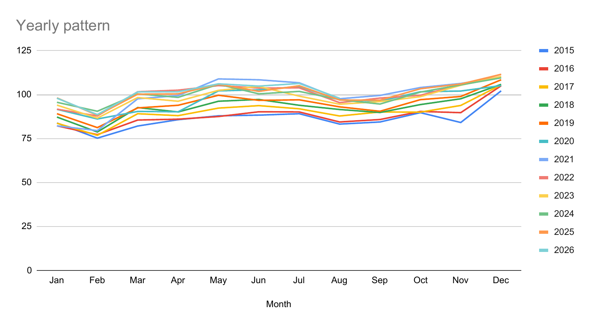

# Retail demand forecasting: five simple methods compared

A comparison of five simple forecasting methods on Eurostat monthly retail sales for five countries. **Seasonal naive** (repeat the same month of last year) wins almost every test.

## Why this project

- A forecast is only useful if it beats a **simple baseline**. If it does not beat the baseline, the extra work adds nothing.
- I tested which simple method beats the baseline, and by how much, on five countries and four test years.
- Skills shown: forecasting, forecast accuracy measures (**WAPE**, **MAPE**, **bias**), Excel and Google Sheets formulas, and attention to detail.

## The question

Which simple forecasting method should a demand planning team use as its starting point, and how much better is it than the most basic forecast?

The audience is a **demand planning team** that has to explain and defend its choice of forecast method.

## Key results

Netherlands, test year 2025:

| Method | WAPE | MAPE | Bias | Improvement over naive |
|---|---|---|---|---|
| naive | 8.56% | 8.88% | +8.23% | 0% |
| seasonal_naive | 1.52% | 1.54% | −1.08% | 82.2% |
| moving_average (3 months) | 5.39% | 5.64% | +4.24% | 37.0% |
| 12_month_average | 4.43% | 4.45% | −1.08% | 48.3% |
| linear_trend | 4.90% | 5.12% | +3.64% | 42.8% |

Lower WAPE and MAPE are better. Bias close to 0 is better. Higher improvement is better.

- **Seasonal naive had the lowest WAPE in 19 of 20 tests**, across 5 countries and 4 test years (2022 to 2025).
- **The one exception is Germany 2022.** There the 12-month average won (WAPE 4.38% against 4.84%).
- **Naive is always the worst.** It repeats the December peak for all 12 months, so it is always too high.
- Seasonal naive removed **60% to 95%** of the naive error across all countries and test years.

## Data

- **Source:** Eurostat, dataset `sts_trtu_m` (turnover and volume of sales in wholesale and retail trade, monthly). [Link to my Eurostat view](https://ec.europa.eu/eurostat/databrowser/view/STS_TRTU_M__custom_23441896/default/table).
- **Downloaded:** 2026-10-21.
- **Countries:** Netherlands (NL), Germany (DE), France (FR), Spain (ES), Italy (IT).
- **Period:** January 2015 to August 2026. That is **140 monthly values per country**, with no gaps.

Filters used:

| Filter | Code | Meaning |
|---|---|---|
| Indicator | `VOL_SLS` | Volume of sales |
| Activity | `G47` | Retail trade, except motor vehicles and motorcycles |
| Unit | `I21` | Index, 2021 = 100 |
| Seasonal adjustment | `NSA` | Unadjusted |

What the numbers mean:

- **Index, 2021 = 100.** The average month in 2021 is 100, so a value of 110 means 10% more sales volume than that.
- **Volume, not euros.** The index tracks how much was sold, not the money value of the sales.
- **Unadjusted.** The seasonal pattern is still in the numbers, with high months such as December and low months such as February.

**Why unadjusted data?** Seasonally adjusted data has the seasonal pattern removed, so a test of seasonal methods would be meaningless on it.

The `raw` tab holds the full Eurostat download, which also contains other countries and other activity codes, including food and non-food. I only used `G47` for the five countries above.

### Data quality flags

Eurostat marks some values with a flag, where **p** means provisional and **e** means estimated.

| Country | Flags (activity G47) | Effect on the test years |
|---|---|---|
| NL | p from January 2026 to August 2026 | None. 2022 to 2025 are not flagged. |
| DE | p in every month | All German results use provisional data. |
| FR | p from August 2024 to July 2026, e in August 2026 | The whole 2025 test year is provisional. |
| ES | p in July and August 2026 | None. |
| IT | No flags | None. |

- **No rows were deleted.** Flagged values are used as they are.
- **Provisional numbers can still change**, so the results for Germany and France may change when Eurostat revises its data.
- The Netherlands flags come from the `raw_NL` tab, but my notes in the `note` tab do not mention them.

## Method

### Training and test rules

- **Test years:** 2022, 2023, 2024 and 2025. Each one is a separate test (a **backtest**: a test on past data where the answer is already known).
- **Training data:** always starts in **January 2015** and ends in the **December before the test year**. For 2025 that is January 2015 to December 2024 (120 months).
- **One forecast per test year.** All 12 months are forecast at once at the end of December, and the forecast is not updated month by month.

### The five methods

| Method | Rule in plain English | Example (Netherlands, forecast for 2025) |
|---|---|---|
| naive | Repeat the last training month for every month. | Every month of 2025 = December 2024 = 109.5 |
| seasonal_naive | Use the same month one year earlier. | January 2025 = January 2024 = 95.6 |
| moving_average (3 months) | Average of the last 3 training months, for every month. | Average of October to December 2024 = 105.47 |
| 12_month_average | Average of the last 12 training months, for every month. | Average of January to December 2024 = 100.08 |
| linear_trend | A straight line fitted on all training months, then extended (Excel `FORECAST.LINEAR`). | January 2025 = 104.04 |

### The four scores

Error = forecast − actual. A positive error means the forecast was too high.

| Score | Formula | What it tells you |
|---|---|---|
| **WAPE** (weighted absolute percentage error) | sum of absolute errors / sum of actuals | How wrong the forecast was overall, in %. Lower is better. |
| **MAPE** (mean absolute percentage error) | average of (absolute error / actual) | The average monthly % error. Lower is better. |
| **Bias** | sum of errors / sum of actuals | Too high (+) or too low (−) on average. Close to 0 is better. |
| **Improvement over naive** | 1 − (method WAPE / naive WAPE) | Share of the naive error that the method removes. Higher is better. |

**Why WAPE is the main score.** MAPE divides each error by that month's own actual, so errors in small months such as February count for more. WAPE divides the total error by total sales, so every unit of sales counts the same.

## Results

### Netherlands, 2025

| Method | WAPE | MAPE | Bias | Improvement over naive |
|---|---|---|---|---|
| naive | 8.56% | 8.88% | +8.23% | 0% |
| seasonal_naive | 1.52% | 1.54% | −1.08% | 82.2% |
| moving_average (3 months) | 5.39% | 5.64% | +4.24% | 37.0% |
| 12_month_average | 4.43% | 4.45% | −1.08% | 48.3% |
| linear_trend | 4.90% | 5.12% | +3.64% | 42.8% |

TODO: add image `images/forecasts-vs-actual-nl-2025.png` (the chart in the `forecasts` tab).

TODO: add image `images/wape-by-method.png` (the chart in the `accuracy` tab).

What the table shows:

- **Seasonal naive wins clearly.** Its WAPE is 1.52%, and it removes 82.2% of the naive error.
- **Naive is too high by 8.23%.** It repeats December 2024 (109.5) for every month, and December is the peak of the year.
- **The 3-month average is also too high (+4.24%).** It averages October to December, which are strong months.
- **Seasonal naive and the 12-month average have the same bias (−1.08%).** This is true by construction: both forecasts add up to the same 2024 total, but the 12-month average spreads it evenly over the year.
- **But their WAPE is very different (1.52% against 4.43%).** The flat 12-month average misses the seasonal shape, so its errors cancel out in the bias but not in the WAPE.
- This is why you need **both accuracy and bias**. Bias alone would call these two methods equal.

### Other countries, 2025

| Country | Winner | WAPE | Bias | Naive WAPE | Improvement over naive |
|---|---|---|---|---|---|
| DE | seasonal_naive | 3.23% | −2.79% | 8.71% | 62.9% |
| FR | seasonal_naive | 2.73% | −2.73% | 18.57% | 85.3% |
| ES | seasonal_naive | 3.92% | −3.92% | 14.07% | 72.1% |
| IT | seasonal_naive | 0.97% | +0.50% | 21.35% | 95.4% |

- **Seasonal naive wins in every country in 2025.**
- Its bias is negative in DE, FR and ES, so it forecast too low there. In Spain, 2025 grew faster than 2024.
- Naive was too high in every country: by 7.80% (DE), 17.60% (FR), 13.18% (ES) and 21.26% (IT).

### Does the winner hold?

Winner (lowest WAPE) by country and test year, from the `country_summary` tab:

| Country | 2022 | 2023 | 2024 | 2025 |
|---|---|---|---|---|
| NL | seasonal_naive | seasonal_naive | seasonal_naive | seasonal_naive |
| DE | 12_month_average | seasonal_naive | seasonal_naive | seasonal_naive |
| FR | seasonal_naive | seasonal_naive | seasonal_naive | seasonal_naive |
| ES | seasonal_naive | seasonal_naive | seasonal_naive | seasonal_naive |
| IT | seasonal_naive | seasonal_naive | seasonal_naive | seasonal_naive |

WAPE of seasonal naive:

| Country | 2022 | 2023 | 2024 | 2025 |
|---|---|---|---|---|
| NL | 3.87% | 2.23% | 2.31% | 1.52% |
| DE | 4.84% | 3.92% | 2.63% | 3.23% |
| FR | 3.47% | 2.23% | 2.30% | 2.73% |
| ES | 2.62% | 2.32% | 2.58% | 3.92% |
| IT | 3.31% | 2.70% | 0.99% | 0.97% |

- **Seasonal naive wins 19 of 20 tests.** The only loss is Germany 2022, where the 12-month average won (4.38% against 4.84%).
- **Its WAPE stays between 0.97% and 4.84%.**
- **It removes 60% to 95% of the naive error** across all tests, and 60% to 83% for the Netherlands alone.
- **Its bias stays between −3.92% and +3.83%**, and between −1.24% and +1.69% for the Netherlands alone.
- **Naive is the worst method in all 20 tests.** Naive and the 3-month average are too high in all 20 tests, because they repeat the December peak.

### The 2020 check

2020 was the COVID year, so I tested whether it distorts the linear trend. The `linear_trend_no2020` version fits the same straight line but leaves all 2020 months out of the training data.

Change in linear trend WAPE when 2020 is left out (percentage points; minus means better):

| Country | 2022 | 2023 | 2024 | 2025 |
|---|---|---|---|---|
| NL | +0.02 | −0.11 | −0.17 | −0.10 |
| DE | −0.46 | −0.81 | −0.64 | −0.14 |
| FR | +0.57 | +1.02 | +0.52 | +0.22 |
| ES | +0.93 | +0.03 | −0.18 | −0.28 |
| IT | −0.32 | +1.34 | +0.57 | +0.28 |

- **The largest change is 1.34 points** (Italy 2023).
- **Germany gets slightly better in every year**, France gets slightly worse in every year, and Spain and Italy are mixed.
- **The winner never changes.** In the backtest, `linear_trend_no2020` competes as a sixth method, and it never wins.
- **The other methods are not affected**, because they only use the last 12 months before each test year. The earliest test year is 2022, so 2020 is never in those 12 months.

### Patterns I saw



Netherlands, index by month (2021 = 100). Each line is one year.

From my notes in the `note` tab:

- **December is the highest month in all five countries.** February is the lowest in four of them. France is the exception: July and February are its low months.
- **NL:** a steady trend up. 2020 does not really break the pattern. December is still highest, February lowest.
- **DE:** next highest is November, next lowest January. Trend up from 2015 to 2021, a dip in 2022 to 2023, then back up in 2024 to 2025. 2020 did not break the pattern: only April dropped (−4.8% against April 2019).
- **FR:** next highest is August. A steady trend up; 2025 is the highest year. 2020 broke the pattern: March −15%, April −30%, November −14% against 2019 (lockdowns).
- **ES:** next highest is July. Trend up, strongest since 2022. 2020 broke the pattern: April −30%, May −19% against 2019. The whole year was −6%.
- **IT:** next highest is July. No clear trend: flat around 100 until 2022, slightly down since. 2020 broke the pattern: March −23%, April −33%, May −14% against 2019. The whole year was −7%.

## What this means for a planner

- **Start with seasonal naive as the baseline.** Any new method should have to beat it before you use it.
- **Naive is a poor baseline for seasonal data.** Beating it proves very little, because it is so easy to beat.
- **Check bias as well as accuracy.** Two methods can have the same bias and very different accuracy.
- **Track forecast errors all the time.** The winner changed once (Germany 2022), and results can change when the data or the market changes.

## Limits

- **National sales index, not product demand.** The data is one index per country, not sales of single products. It shows I can test a forecast method, but it does not show product range planning.
- **One data source and one sector.** Only Eurostat retail trade data was used, so the result says what fits this data, not that seasonal naive works everywhere.
- **Simple methods only.** The five methods are basic rules, not advanced models.
- **Exponential smoothing was not tested.** It was in the original plan (Excel `FORECAST.ETS`), but I built the project in Google Sheets, which does not have this function. I used a straight-line trend instead.
- **The food and non-food split was not done.** The download contains food and non-food series, but I did not analyse them.
- **Some recent data is provisional.** See [Data quality flags](#data-quality-flags). Germany and France are affected most.
- **Only four test years.** One good year can be luck.
- **2025 numbers may change.** For some countries they are provisional, and Eurostat may revise them.

## Next steps

- Test exponential smoothing: `FORECAST.ETS` or Holt-Winters, in Excel or Python.
- Do the food and non-food split, using the same tests.

## How to reproduce

1. **Download the data.** Open the Eurostat dataset `sts_trtu_m`. Set indicator `VOL_SLS`, unit `I21`, seasonal adjustment `NSA`, monthly, January 2015 to August 2026. My download also had other countries and activity codes, and step 3 keeps only `G47`.
2. **Paste it into `raw`.** Copy the rows for each country into its own tab (`raw_NL`, `raw_DE` and so on).
3. **Build `clean_XX`.** Keep only activity `G47`. One row per month: the month and the index value, sorted by date.
4. **Build `forecasts_XX`.** For each of the 12 test months, add the five forecasts, the actual value and the error (forecast − actual).
5. **Build `accuracy_XX`.** Calculate WAPE, MAPE, bias and improvement over naive for each method.
6. **Build `backtest_XX`.** Repeat steps 4 and 5 for each test year (2022 to 2025). Add `linear_trend_no2020`.
7. **Repeat for each country.** Then collect the results in `country_summary`.

**Note on formulas.** I built the workbook in Google Sheets and saved it as `.xlsx`. Some formulas use Google Sheets functions (for example `FILTER` inside `FORECAST.LINEAR`), so Excel shows the saved values for these cells but may not recalculate them.

### Workbook tabs

| Tab | What it holds |
|---|---|
| `note` | My notes: data source, download date, goals, written results, flags, country notes |
| `raw` | The full Eurostat download |
| `raw_NL`, `raw_DE`, `raw_FR`, `raw_ES`, `raw_IT` | The rows of `raw` for one country |
| `clean_NL` … `clean_IT` | Month and index, one row per month, activity `G47` only |
| `Year-over-Year grid` (and `_DE`, `_FR`, `_ES`, `_IT`) | The pattern by month and by year, with a chart |
| `Charts` | Charts of the pattern by month and by year |
| ` forecasts` (Netherlands, note the leading space) and `forecasts_DE` … `forecasts_IT` | 2025 forecasts, actuals and errors |
| `accuracy (result page)` (Netherlands) and `accuracy_DE` … `accuracy_IT` | WAPE, MAPE, bias and improvement over naive for 2025 |
| `backtest` (Netherlands) and `backtest_DE` … `backtest_IT` | The same test for 2022 to 2025, plus `linear_trend_no2020` |
| `country_summary` | Winner, seasonal naive WAPE, naive WAPE, improvement and bias by country and test year, plus the 2020 check |

## Repository structure

```
retail-demand-forecasting/
├── README.md
├── excel/
│   └── Testing_forecast_method.xlsx
└── images/
    └── yearly-pattern-nl.png
```

TODO: add the other two chart images named above to `images/`.

## Data source

Eurostat, dataset `sts_trtu_m`, downloaded on 2026-10-21.

## Author

Eliza C. Huang
